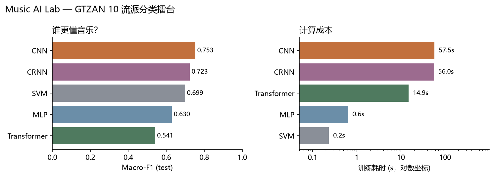

# 走进音乐人工智能 · 音乐流派分类擂台

> 选修课《走进音乐人工智能》小组项目。用同一批音乐让多套模型听歌、辨曲、比拼，
> 回答「AI 到底懂不懂音乐」。

本文件由原始对话式计划整理而来：把「为什么做、怎么做、做到哪、下一步做什么」
按项目文档的结构逐节落地，并记录当前 MVP 的真实进度。研究过程与每次实验的
时间线见 [`docs/research_log.md`](docs/research_log.md)。

---

## 一、项目定位

项目不做传统的「介绍几种神经网络 + 展示准确率」学术汇报，而是一个可现场交互的
**音乐 AI 实验室 + 模型擂台赛 + 现场盲测**。全部实验在 WSL2 + PyTorch 上完成，
汇报时用真实训练出的权重现场推理，不使用预设结果。

整个项目围绕五个问题展开：

1. AI 能否从音频中识别音乐流派？
2. CNN、RNN、Transformer 到底谁更会「听歌」？
3. 预训练模型能否以更少训练成本取得更好效果？
4. 模型究竟学到了音乐特征，还是只记住了数据？
5. 面对一首没听过的歌，AI 能给出什么判断，又会在哪里翻车？

项目分为两条主线：

- **实验主线**：统一数据集与评估标准，训练多个 Baseline，做消融与错误分析。
- **展示主线**：把模型包装成可现场操作的「音乐 AI 鉴定所」，上传音频即可查看
  分类结果、置信度、模型分歧与音频可视化。

---

## 二、技术路线

### 2.1 数据集

主实验首选 **FMA-small**：8,000 首、30 秒音频、8 个均衡流派，适合比较模型在较丰富
音乐数据上的泛化表现；原始压缩包约 7.2 GiB，解压后需要额外存储。音频授权需按
具体曲目核对，不默认所有歌曲都可公开分发。

备选 **GTZAN**：约 1,000 段、10 个流派、每段约 30 秒。适合快速跑通数据读取、
训练循环与演示界面；但数据规模小，且已有研究指出其存在重复音频与标签错误，
不宜把高准确率直接解释为模型很强（参见 arXiv:1306.1461）。

**本项目实际选择**：MVP 阶段使用 GTZAN，原因是流水线验证优先、体积可控；
FMA-small 作为后续主实验。GTZAN 的已知问题通过数据清洗处理：剔除 1 首无法解码的
`jazz.00054`，按 MD5 去除 14 个重复副本，最终使用 **985 首**。切换原因与数据细节
记录在 [`docs/data_card.md`](docs/data_card.md) 与 `data/splits/stats.json`。

> 注意：8 GB 显存不等于存储容量，FMA-small 的 7.2 GiB 是磁盘占用。若 WSL 磁盘
> 紧张，先用 GTZAN 验证流水线，再决定是否下载完整 FMA-small。

### 2.2 模型清单

| 编号 | 模型 | 输入 | 作用 |
|---|---|---|---|
| Baseline 0 | SVM（RBF） | 人工音频特征 | 传统机器学习基准线 |
| Baseline 1 | MLP | 同一套人工特征 | 检验「神经网络是否一定更强」 |
| Baseline 2 | CNN | Log-Mel 频谱图 | 从时频图像学习鼓点、音色、频率分布等局部模式 |
| Baseline 3 | CRNN（CNN + GRU） | Log-Mel | 用循环层学习特征随时间的变化 |
| Baseline 4 | 轻量 Transformer | 降采样频谱帧/特征序列 | 用自注意力学习远距离音乐上下文 |
| Bonus | 预训练 AST | 频谱图 | 冻结主干训练分类头，有余力再小学习率微调 |

实验原则：SVM 与 MLP 使用完全相同的人工特征；CNN、CRNN、Transformer 使用相同的
音频来源与固定划分；AST 单独标记为「迁移学习组」，避免把预训练知识的收益误说成
架构优势。时间有限时优先保证五个自建 Baseline 全部可复现，AST 放第二优先级。

### 2.3 三套现场体验

**功能 A：AI 音乐鉴定所（必做）** — 上传一段音频，输出预测流派、Top-3 类别、
置信度、频谱图，并比较 CNN / CRNN / Transformer 的预测差异。这是现场演示的核心。

**功能 B：AI 模型擂台赛（必做）** — 同一段音乐由多个模型同时预测，展示准确率
排行榜、混淆矩阵、推理时间与模型大小。现场可先让观众猜，再揭晓结果，是 PPT 的
视觉重点。

**功能 C：一首歌的「性格变化」（进阶）** — 把一首歌切成多个 5–10 秒片段分别预测，
绘制时间轴上的预测变化与置信度，例如开头是安静钢琴、随后进入强节奏段落时，
观察模型判断是否改变。这不是预测未来音频，而是对不同时间片段分类，符合当前
技术路线，也避免为了「预测」二字引入音乐生成任务。

**延伸实验：AI 最容易被什么骗过？** — 同一段音乐改变音量、加入轻微噪声、缩短
片段，观察不同模型的判断是否改变，用直观方式讲模型鲁棒性与人工智能局限。

---

## 三、实验设计规范

项目的核心亮点应是「用公平、可复现的实验，发现不同模型在听音乐时的优势与局限」，
而不是「跑了五种模型」。所有模型遵循同一份协议：

| 项目 | 统一设置 |
|---|---|
| 主数据集 | FMA-small（8 流派）；本项目 MVP 为 GTZAN（10 流派，清洗后 985 首） |
| 训练 / 验证 / 测试 | 70% / 15% / 15%，按曲目分层 |
| 随机种子 | 固定 42（并补跑 123 / 2024），保存具体划分文件 |
| 音频采样率 | 22,050 Hz |
| 训练输入 | 5 秒片段，或等价固定长度特征 |
| 传统模型特征 | MFCC、频谱质心、过零率、节奏等 209 维 |
| 深度模型输入 | 64×216 Log-Mel 频谱图 |
| 模型选择 | 仅依据验证集 |
| 最终测试 | 所有配置确定后，只在测试集评估一次 |
| 重复实验 | 核心模型至少 3 个随机种子复测 |

**先按曲目划分，再切片。** 绝不能把同一首歌的前 5 秒放进训练集、后 5 秒放进测试集，
否则模型可能只是识别了听过的曲目。预处理器（标准化器、Mel 归一化统计量）只在
训练集上拟合。

评估不只看 Accuracy，每个模型都记录四类结果：

- **分类效果**：Accuracy、Macro-F1、各类别 F1、混淆矩阵。Macro-F1 尤其适合观察
  模型是否只擅长少数流派。
- **计算成本**：训练时间、单段音频推理延迟、可训练参数量、模型文件大小、峰值显存。
- **学习过程**：训练/验证损失曲线、验证集表现随 epoch 的变化、过拟合情况。
- **可解释性与失败案例**：哪些流派最容易混淆、不同模型为何意见不一致、
  改变片段长度后预测是否稳定。

不预设冠军：CNN 可能在训练预算下表现出色，Transformer 也可能没有优势；预训练
AST 可能更好，但要计算额外成本并说明预训练数据来源。这些不确定性正是实验价值。

---

## 四、项目结构

```
music-ai-lab/
├── configs/                 # dataset.yaml / baseline.yaml / experiments.yaml
├── data/
│   ├── raw/                 # 原始音频（不提交）
│   ├── processed/           # 特征缓存 features.npz（不提交）
│   └── splits/              # splits.csv, stats.json
├── src/
│   ├── data/                # prepare_dataset.py, audio_features.py
│   ├── models/              # cnn.py（CNN / CRNN / Transformer）
│   ├── train_classical.py   # SVM + MLP
│   ├── train_cnn.py         # 深度模型统一训练器
│   ├── evaluate.py          # 图表 + 汇总
│   ├── predict.py           # 单文件推理
│   └── metrics.py
├── scripts/                 # run_all.sh, extract_features.py, env_audit.py
├── app/demo.py              # Streamlit 音乐 AI 鉴定所
├── tests/                   # 协议测试
├── checkpoints/             # 权重（不提交）
├── results/                 # metrics.csv、预测、图表、summary.md
├── docs/                    # 环境报告、研究日志、数据卡、审计、验收清单
├── requirements.txt
└── README.md
```

`configs/` 统一管理超参数，`results/` 保存原始实验结果，`checkpoints/` 保存权重。
所有结论写入文件，不允许只在聊天窗口里报告准确率，以便后续制作 PPT 时追溯。
数据集与模型权重不提交进代码仓库。

---

## 五、分阶段计划与进度

计划拆成六个可验收阶段，对应 Agent 执行时的阶段 A–H：

| 阶段 | 时间 | 内容 | 验收标准 | 当前状态 |
|---|---|---|---|---|
| 01 环境审计与数据检查 | 第 1 天 | 检查 Python/PyTorch/CUDA/GPU/磁盘，接入数据集，统计损坏文件、标签分布、时长与采样率 | GPU 可用；数据可读；生成统计表与固定划分 | ✅ 完成（GPU 沙箱问题已定位并解决） |
| 02 特征工程与传统 Baseline | 第 2–3 天 | 实现 MFCC 等特征、标准化、SVM 与 MLP；标准化器只在训练集拟合 | 两个模型可独立训练、评估、保存并复现预测 | ✅ 完成 |
| 03 搭建深度学习擂台 | 第 4–6 天 | 实现 CNN、CRNN、轻量 Transformer；统一训练循环、优化器、早停、日志、权重保存与显存监控 | 三种模型各完成一次小规模训练，输出同格式指标 | ✅ 完成（显存监控未单独记录） |
| 04 批量实验与预训练模型 | 第 7–9 天 | 正式实验、至少 3 个随机种子；资源允许时接入 AST | 每个模型有配置、日志、最佳权重、验证记录与测试指标 | ◐ 3 seed 已完成；AST 未做 |
| 05 错误分析与演示应用 | 第 10–11 天 | 排行榜、混淆矩阵、训练曲线、推理时间；Streamlit 上传/预测/置信度/多模型比较 | 对新音频真实推理，不能是预设结果 | ◐ Demo 完成；错误分析待深化 |
| 06 复现检查、PPT 与彩排 | 第 12–14 天 | 干净环境重跑关键实验，图表数字可追溯，准备盲测音频、备用录屏、讲稿 | 任何组员按 README 可重现，现场按时演示 | ⬜ 未开始 |

日程有意留出缓冲：如果数据下载或 AST 耗时较长，可以牺牲 AST 微调，不牺牲基础
模型、测试集规范与最终 Demo。

### 5.1 工作原则

- 先审计环境，再修改环境；不未经确认重装 PyTorch 或 CUDA。
- 每次只完成一个阶段，执行测试并报告结果后再进入下一阶段。
- 不伪造实验结果、运行日志、数据集内容或准确率。
- 不混用训练集、验证集、测试集；先按曲目划分再切片。
- 预处理器只在训练集上拟合。
- 所有随机种子、数据划分、模型配置与软件版本必须记录。
- 测试集只用于最终评估；模型选择与调参只用训练集与验证集。
- GPU OOM 时依次减小 batch size、缩短片段、缩小模型、启用混合精度，
  不静默更改实验设置。
- 所有结论必须由实际运行的实验支持。

### 5.2 每阶段汇报格式

阶段结束后报告：已完成任务、实际执行命令、关键日志与测试结果、新建/修改文件、
未解决问题、GPU/内存/磁盘使用情况、下一阶段计划、是否满足验收标准。
遇到错误先定位修复再验证，不以解释代替完成。

---

## 六、当前进度（最小 MVP）

本轮目标是跑通最小闭环：环境 → 数据 → 特征 → 五个 Baseline → 评估图表 →
真实推理 Demo。**该闭环已完成并通过独立审计。**

### 6.1 已完成

- 环境：复用 CUDA conda 环境 `DataAnalysis`（Python 3.12 / torch 2.12.1+cu130 /
  RTX 4060 Laptop 8GB），依赖见 `requirements.txt`。
- 数据：GTZAN 清洗后 985 首，按曲目 70/15/15（689/149/147），seed=42 固定。
- 特征：209 维人工特征 + 64×216 Log-Mel，一次缓存、五个模型共用。
- 模型：SVM / MLP / CNN / CRNN / 轻量 Transformer × 3 seeds，共 15 次训练。
- 评估：`results/metrics.csv`、逐类 F1、混淆矩阵、训练曲线、排行榜、预测 CSV。
- Demo：Streamlit 上传音频实时推理，调用真实 checkpoint，已冒烟验证 HTTP 200。
- 文档：环境报告、数据卡、研究日志、验收清单、独立审计报告。

### 6.2 结果（test，n=147，3 seeds 均值 ± 标准差）

| 模型 | Accuracy | Macro-F1 | 训练耗时 | 单片段推理 | 参数量 | 模型大小 |
|---|---|---|---|---|---|---|
| CNN | **0.755 ± 0.007** | **0.753 ± 0.006** | 57.5 s | 0.76 ms | 592,554 | 2.39 MB |
| CRNN | 0.726 ± 0.034 | 0.723 ± 0.034 | 56.0 s | 0.76 ms | 418,986 | 1.69 MB |
| SVM | 0.708 ± 0.000 | 0.699 ± 0.000 | 0.2 s | 0.07 ms | 140,657 | 1.23 MB |
| MLP | 0.633 ± 0.051 | 0.630 ± 0.055 | 0.6 s | 0.02 ms | 87,946 | 1.07 MB |
| Transformer | 0.544 ± 0.025 | 0.541 ± 0.019 | 14.9 s | 0.26 ms | 302,474 | 1.22 MB |



可直接用于汇报的观察：

- 训练最久的 CNN 只比 SVM 高约 4.7 个百分点，**深度模型不是免费午餐**。
- CNN 三个种子非常稳定（±0.7），CRNN 波动 ±3.4，MLP ±5.1（小样本对初始化敏感）。
- 最佳模型 CNN 在 `rock` 上最差（F1 0.43），`classical` 最好（F1 0.93）。
- 轻量 Transformer 在 985 首数据上严重过拟合（训练 loss→0，验证 loss 抬头），
  三个种子都只有 52–56%。
- 真实翻车案例：测试集 `jazz.00003` 被 CNN 以 99.6% 置信度判成 `classical`，
  适合现场讲「AI 也会自信地犯错」。

### 6.3 质量保证

- `tests/test_protocol.py` 自动校验：划分无重叠、特征与划分对齐、标准化器只拟合
  训练集、checkpoint 可推理；`pytest` 4 项全过。
- 独立校验员两轮只读审计均为 **6/6 PASS**：无数据泄漏、测试集未参与调参、
  结果与预测 CSV/JSON 完全对账；同 seed 重训得到逐字节相同的 checkpoint。
  详见 [`docs/audit_report.md`](docs/audit_report.md)。
- 开启 cuDNN 确定性后，seed 42 复跑结果逐位一致（0.7483 / 0.7493）。

---

## 七、快速开始

环境：WSL2 Ubuntu 22.04，复用带 CUDA 的 conda 环境 `DataAnalysis`。

```bash
cd MUSIC_AI
PY=/home/weizai0v0/.apps/anaconda3/envs/DataAnalysis/bin/python

# 1) 数据（首次需下载约 1.2 GB；已有 data/raw/gtzan 可跳过 --download --extract）
$PY -m src.data.prepare_dataset --download --extract --audit --split

# 2) 特征缓存（209 维人工特征 + 64×216 Log-Mel）
$PY scripts/extract_features.py --workers 8

# 3) 传统 Baseline
$PY -m src.train_classical --models svm mlp --seeds 42 123 2024

# 4) 深度 Baseline（自动使用 GPU）
$PY -m src.train_cnn --model cnn --seeds 42 123 2024 --epochs 30
$PY -m src.train_cnn --model crnn --seeds 42 123 2024 --epochs 30
$PY -m src.train_cnn --model transformer --seeds 42 123 2024 --epochs 30

# 5) 图表与汇总
$PY -m src.evaluate

# 6) 协议测试
$PY -m pytest -q tests

# 7) 现场 Demo
$PY -m streamlit run app/demo.py
```

一键脚本：`bash scripts/run_all.sh`（可用 `PYTHON=...` 覆盖解释器）。

单文件推理：

```bash
$PY -m src.predict data/raw/gtzan/genres/classical/classical.00001.wav --model cnn
```

> SVM 的 `predict()`（OVO 决策）与 `predict_proba()`（Platt 校准）在约 5–7% 样本上
> Top-1 不一致；准确率一律按 `predict()` 计算，Demo 概率柱状图可能与 Top-1 标签
> 略有出入，汇报时建议说明。

---

## 八、RTX 4060 8GB 下的参数建议

| 参数 | 建议起点 | 本项目实际 |
|---|---|---|
| 音频采样率 | 22,050 Hz | 22,050 Hz |
| 每个训练样本 | 5 秒音频 | 5 秒中心片段 |
| Log-Mel | 64 或 128 个 Mel bins | 64 bins |
| CNN batch size | 32（OOM 降至 16/8） | 32 |
| CRNN batch size | 16–32 | 32 |
| Transformer batch size | 8–16 | 32（模型很小，未 OOM） |
| 优化器 | AdamW | AdamW |
| 初始学习率 | CNN/CRNN 1e-3；Transformer 1e-4 | 均为 1e-3 + Cosine |
| 最大训练轮数 | 30，配合早停 | 30，patience 8 |
| 数值精度 | 支持时 AMP | 未启用（规模小） |
| 检查点 | 验证集 Macro-F1 最佳 | 同名实现 |

提前完成的三件事：`nvidia-smi` 确认 GPU；把音频预处理缓存成固定形状特征；
用 `num_workers`、特征缓存与批量提取减少 GPU 等 CPU。

如果 WSL 中 PyTorch 看不到 GPU，优先排查 Windows NVIDIA 驱动与 WSL GPU 支持，
不要急着在 Ubuntu 内安装独立 Linux 显卡驱动。本次实际遇到的却是另一类问题：
**进程沙箱拦截 `/dev/dxg`**，详见第九节。

---

## 九、环境与排障

首次运行时 `nvidia-smi` 报：

```
Failed to initialize NVML: GPU access blocked by the operating system
```

且 `cuInit(0)` 返回 100（CUDA_ERROR_NO_DEVICE）。排查结论：

- Windows 侧 `nvidia-smi.exe` 正常（RTX 4060 Laptop / 驱动 595.79 / CUDA 13.2），
  排除驱动问题；
- WSL 中 `open('/dev/dxg')` 返回 EACCES（节点权限是 666），排除文件权限问题；
- 将 DSH 会话文件策略从 `workspace-write` 切到 `danger-full-access` 后，
  `open` 成功、`cuInit=0`、设备数 1 —— 根因是**沙箱拦截设备访问**。

详细证据见 [`docs/environment_report.md`](docs/environment_report.md)，时间线见
[`docs/research_log.md`](docs/research_log.md)。

---

## 十、PPT 故事线

汇报按「有故事线的实验报告」组织，而不是按模型教科书顺序：

1. **开场：人类能听懂，AI 能听懂吗？** 放三段差异明显的音乐让同学猜流派，
   展示 AI 的 Top-3 判断，建立问题。
2. **给 AI 一双耳朵**：用波形图与频谱图解释音频如何变成数字表示，
   传统特征与 Log-Mel 有什么区别。
3. **五位选手登场**：用生活化比喻介绍模型——SVM 手工划分边界，MLP 组合特征，
   CNN 寻找局部模式，CRNN 观察模式随时间变化，Transformer 建立远距离联系。
4. **实验室公布成绩**：展示真实排行榜、混淆矩阵、训练时间与显存使用，
   解释冠军赢在哪里，而不是只念准确率。
5. **现场盲测：AI 会不会翻车？** 用模型没见过的音频，再试短片段、风格混合、
   改变音量，让观众先猜再揭晓。
6. **结尾：AI 到底懂不懂音乐？** 讨论标签能否代表音乐本身、置信度是否等于正确率、
   模型能否理解文化背景与情绪。落到一个观点：模型擅长学习统计规律，
   分类准确不等于真正理解音乐。

---

## 十一、验收清单（12 项 Definition of Done）

| # | 条目 | 状态 | 证据 / 缺口 |
|---|---|---|---|
| 1 | 环境审计报告与可复现依赖 | ✅ | `docs/environment_report.md`、`requirements.txt` |
| 2 | 数据集说明、授权检查与固定划分 | ✅ | `docs/data_card.md`、`data/splits/*` |
| 3 | 五个 Baseline 均可运行 | ✅ | `checkpoints/*`、`results/metrics.csv` |
| 4 | 训练日志、权重与配置完整 | ◐ | 权重 + 逐 epoch history + configs；缺独立 stdout 日志 |
| 5 | Accuracy、Macro-F1 与混淆矩阵 | ✅ | `results/metrics.csv`、`figures/confusion_matrices.png` |
| 6 | 至少三个随机种子的核心结果 | ✅ | 5 模型 × 3 seed |
| 7 | 训练时间、推理延迟、模型大小与显存 | ◐ | 前三项有；峰值显存未记录 |
| 8 | 至少两个错误案例与一次鲁棒性实验 | ◐ | 混淆矩阵已定位 rock→country/blues；鲁棒性未做 |
| 9 | 可上传音频的真实推理 Demo | ✅ | `app/demo.py` + `src/predict.py` |
| 10 | 模型排行榜与可视化图表 | ✅ | `results/figures/*.png`、`results/summary.md` |
| 11 | PPT 数字可追溯到结果文件 | ◐ | 数字均来自 `results/`；PPT 未制作 |
| 12 | 备用录屏、演示音频与彩排 | ⬜ | 未开始 |

---

## 十二、创新点

如果只是「在同一数据集上跑五种模型」，项目会像常规课程作业。创新集中在三方面：

1. **公平比较**：不只比准确率，还比计算成本、鲁棒性与泛化能力；统一划分、
   同一批片段、预处理只在训练集拟合。
2. **可视化体验**：把模型分歧、片段变化和失败案例做成观众看得懂的交互演示。
3. **对 AI 的反思**：研究模型学到的是流派特征，还是片段长度、录音质量、
   曲目重复等捷径。

---

## 十三、下一步计划

| 优先级 | 任务 | 说明 |
|---|---|---|
| P0 | 错误分析深化 | rock↔country、disco↔pop 混淆案例听感对照；`jazz.00003` 自信误判 |
| P0 | 鲁棒性实验 | 片段长度 3 s / 10 s、加噪、音量缩放，比较五个模型稳定性 |
| P1 | AST 迁移学习 | 冻结主干训练分类头，记录权重来源与额外成本 |
| P1 | FMA-small 主实验 | 若磁盘与时间允许，替换主数据集并重新划分 |
| P2 | 片段级预测时间轴 | 功能 C：把一首歌切片预测，画置信度随时间变化 |
| P2 | PPT 与彩排 | 按第十节故事线制作，准备盲测音频与备用录屏 |

---

## 十四、已知问题与限制

- **数据集**：MVP 使用 GTZAN，主实验 FMA-small 未下载；GTZAN 存在标签噪声与
  重复曲目，绝对准确率不宜过度解读。
- **显存**：未记录峰值显存；当前 batch 32 远未打满 8 GB。
- **确定性**：开启 cuDNN 确定性后本机可逐位复现；但
  `adaptive_avg_pool2d_backward_cuda` 无确定性实现，跨硬件/版本不保证。
- **SVM 概率**：`predict()` 与 `predict_proba()` 存在少量不一致（见第七节）。
- **鲁棒性**：尚未做片段长度/噪声/音量扰动实验。
- **AST / PPT / 彩排**：未开始。

---

## 十五、参考

- FMA 数据集与说明：<https://github.com/mdeff/fma>
- GTZAN（HuggingFace）：<https://huggingface.co/datasets/marsyas/gtzan>
- Sturm, B. L. (2013). *The GTZAN dataset: Its contents, its faults, their effects
  on evaluation, and its future use.* arXiv:1306.1461
- AST 文档：<https://huggingface.co/docs/transformers/en/model_doc/audio-spectrogram-transformer>
- 完整实验记录：[`docs/experiment_log.md`](docs/experiment_log.md)
- 研究日志（按时间）：[`docs/research_log.md`](docs/research_log.md)
- 验收清单：[`docs/mvp_checklist.md`](docs/mvp_checklist.md)
