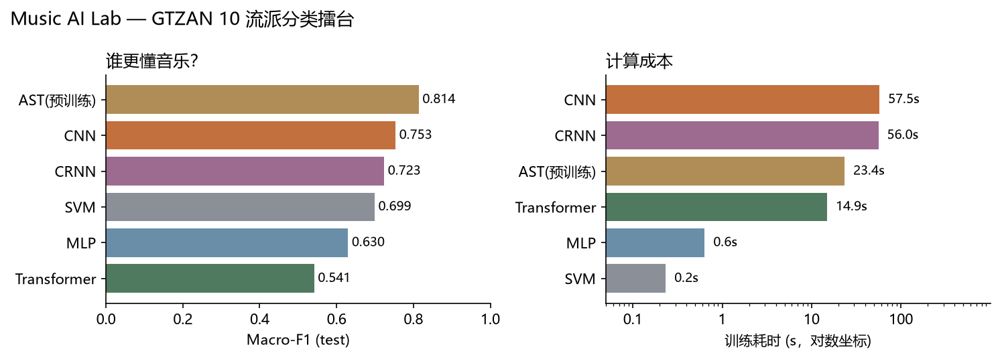
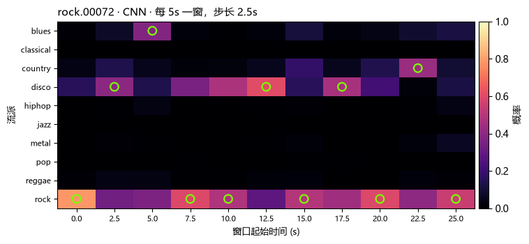

# 走进音乐人工智能 · 音乐流派分类擂台

> 选修课《走进音乐人工智能》小组项目。用同一批音乐让多套模型听歌、辨曲、比拼，
> 回答「AI 到底懂不懂音乐」。

本文件由原始对话式计划整理而来：把「为什么做、怎么做、做到哪、下一步做什么」
按项目文档的结构逐节落地，并记录当前 MVP 的真实进度。研究过程与每次实验的
时间线见 [`docs/research_log.md`](docs/research_log.md)。

---

## 一、项目定位

项目不做传统的「介绍几种神经网络 + 展示准确率」学术汇报，而是一个可现场交互的
**音乐 AI 实验室 + 模型擂台赛 + 现场盲测**。全部实验在 WSL2 + PyTorch 上完成，
汇报时用真实训练出的权重现场推理，不使用预设结果。

整个项目围绕五个问题展开：

1. AI 能否从音频中识别音乐流派？
2. CNN、RNN、Transformer 到底谁更会「听歌」？
3. 预训练模型能否以更少训练成本取得更好效果？
4. 模型究竟学到了音乐特征，还是只记住了数据？
5. 面对一首没听过的歌，AI 能给出什么判断，又会在哪里翻车？

项目分为两条主线：

- **实验主线**：统一数据集与评估标准，训练多个 Baseline，做消融与错误分析。
- **展示主线**：把模型包装成可现场操作的「音乐 AI 鉴定所」，上传音频即可查看
  分类结果、置信度、模型分歧与音频可视化。

---

## 二、技术路线

### 2.1 数据集

主实验首选 **FMA-small**：8,000 首、30 秒音频、8 个均衡流派，适合比较模型在较丰富
音乐数据上的泛化表现；原始压缩包约 7.2 GiB，解压后需要额外存储。音频授权需按
具体曲目核对，不默认所有歌曲都可公开分发。

备选 **GTZAN**：约 1,000 段、10 个流派、每段约 30 秒。适合快速跑通数据读取、
训练循环与演示界面；但数据规模小，且已有研究指出其存在重复音频与标签错误，
不宜把高准确率直接解释为模型很强（参见 arXiv:1306.1461）。

**本项目实际选择**：MVP 阶段使用 GTZAN，原因是流水线验证优先、体积可控；
FMA-small 作为后续主实验。GTZAN 的已知问题通过数据清洗处理：剔除 1 首无法解码的
`jazz.00054`，按 MD5 去除 14 个重复副本，最终使用 **985 首**。切换原因与数据细节
记录在 [`docs/data_card.md`](docs/data_card.md) 与 `data/splits/gtzan/stats.json`。

> 注意：8 GB 显存不等于存储容量，FMA-small 的 7.2 GiB 是磁盘占用。若 WSL 磁盘
> 紧张，先用 GTZAN 验证流水线，再决定是否下载完整 FMA-small。

### 2.2 模型清单

| 编号 | 模型 | 输入 | 作用 |
|---|---|---|---|
| Baseline 0 | SVM（RBF） | 人工音频特征 | 传统机器学习基准线 |
| Baseline 1 | MLP | 同一套人工特征 | 检验「神经网络是否一定更强」 |
| Baseline 2 | CNN | Log-Mel 频谱图 | 从时频图像学习鼓点、音色、频率分布等局部模式 |
| Baseline 3 | CRNN（CNN + GRU） | Log-Mel | 用循环层学习特征随时间的变化 |
| Baseline 4 | 轻量 Transformer | 降采样频谱帧/特征序列 | 用自注意力学习远距离音乐上下文 |
| Bonus | 预训练 AST | 频谱图 | 冻结主干训练分类头，有余力再小学习率微调 |

实验原则：SVM 与 MLP 使用完全相同的人工特征；CNN、CRNN、Transformer 使用相同的
音频来源与固定划分；AST 单独标记为「迁移学习组」，避免把预训练知识的收益误说成
架构优势。时间有限时优先保证五个自建 Baseline 全部可复现，AST 放第二优先级。

### 2.3 三套现场体验

**功能 A：AI 音乐鉴定所（必做）** — 上传一段音频，输出预测流派、Top-3 类别、
置信度、频谱图，并比较 CNN / CRNN / Transformer 的预测差异。这是现场演示的核心。

**功能 B：AI 模型擂台赛（必做）** — 同一段音乐由多个模型同时预测，展示准确率
排行榜、混淆矩阵、推理时间与模型大小。现场可先让观众猜，再揭晓结果，是 PPT 的
视觉重点。

**功能 C：一首歌的「性格变化」（进阶）** — 把一首歌切成多个 5–10 秒片段分别预测，
绘制时间轴上的预测变化与置信度，例如开头是安静钢琴、随后进入强节奏段落时，
观察模型判断是否改变。这不是预测未来音频，而是对不同时间片段分类，符合当前
技术路线，也避免为了「预测」二字引入音乐生成任务。

**延伸实验：AI 最容易被什么骗过？** — 同一段音乐改变音量、加入轻微噪声、缩短
片段，观察不同模型的判断是否改变，用直观方式讲模型鲁棒性与人工智能局限。

---

## 三、实验设计规范

项目的核心亮点应是「用公平、可复现的实验，发现不同模型在听音乐时的优势与局限」，
而不是「跑了五种模型」。所有模型遵循同一份协议：

| 项目 | 统一设置 |
|---|---|
| 主数据集 | FMA-small（8 流派）；本项目 MVP 为 GTZAN（10 流派，清洗后 985 首） |
| 训练 / 验证 / 测试 | 70% / 15% / 15%，按曲目分层 |
| 随机种子 | 固定 42（并补跑 123 / 2024），保存具体划分文件 |
| 音频采样率 | 22,050 Hz |
| 训练输入 | 5 秒片段，或等价固定长度特征 |
| 传统模型特征 | MFCC、频谱质心、过零率、节奏等 209 维 |
| 深度模型输入 | 64×216 Log-Mel 频谱图 |
| 模型选择 | 仅依据验证集 |
| 最终测试 | 所有配置确定后，只在测试集评估一次 |
| 重复实验 | 核心模型至少 3 个随机种子复测 |

**先按曲目划分，再切片。** 绝不能把同一首歌的前 5 秒放进训练集、后 5 秒放进测试集，
否则模型可能只是识别了听过的曲目。预处理器（标准化器、Mel 归一化统计量）只在
训练集上拟合。

评估不只看 Accuracy，每个模型都记录四类结果：

- **分类效果**：Accuracy、Macro-F1、各类别 F1、混淆矩阵。Macro-F1 尤其适合观察
  模型是否只擅长少数流派。
- **计算成本**：训练时间、单段音频推理延迟、可训练参数量、模型文件大小、峰值显存。
- **学习过程**：训练/验证损失曲线、验证集表现随 epoch 的变化、过拟合情况。
- **可解释性与失败案例**：哪些流派最容易混淆、不同模型为何意见不一致、
  改变片段长度后预测是否稳定。

不预设冠军：CNN 可能在训练预算下表现出色，Transformer 也可能没有优势；预训练
AST 可能更好，但要计算额外成本并说明预训练数据来源。这些不确定性正是实验价值。

---

## 四、项目结构

```
music-ai-lab/
├── configs/                 # dataset.yaml / baseline.yaml / experiments.yaml
├── data/
│   ├── raw/                 # GTZAN 原始音频（不提交）
│   ├── features/            # 提取好的特征缓存（不提交）
│   │   ├── gtzan/           #   features.npz、ast_embeddings.npz
│   │   └── fma/             #   features*.npz、ast_*.npz/npy
│   ├── splits/              # 固定划分，两个数据集各一套
│   │   ├── gtzan/           #   splits.csv, stats.json
│   │   └── fma/             #   splits.csv, splits_tracklevel.csv, stats.json
│   └── fma/                 # FMA-small 音频与元数据（不提交）
├── src/
│   ├── data/                # prepare_dataset.py, audio_features.py
│   ├── models/              # cnn.py（CNN / CRNN / Transformer）
│   ├── train_classical.py   # SVM + MLP
│   ├── train_cnn.py         # 深度模型统一训练器
│   ├── train_ast.py         # AST 冻结主干 + 线性头
│   ├── evaluate.py          # 图表 + 汇总
│   ├── predict.py           # 单文件推理
│   ├── error_analysis.py    # P0 错误分析
│   ├── robustness.py        # P0 七种扰动鲁棒性
│   ├── timeline.py          # P2 滑动窗口时间轴
│   └── metrics.py
├── scripts/                 # run_all.sh, extract_features.py, env_audit.py,
│                            #   run_robustness.py, integrate_ast.py
├── app/demo.py              # Streamlit 音乐 AI 鉴定所
├── tests/                   # 协议测试
├── checkpoints/             # 权重（不提交），按实验分子目录
│                            #   gtzan/、fma/、fma_leak/、fma_ablation/
├── results/                 # 结果，与 checkpoints 子目录一一对应
│                            #   gtzan/、fma/、fma_leak/、fma_ablation/
│                            #   每个含 metrics.csv、预测、图表、summary.md
├── docs/                    # 环境报告、研究日志、数据卡、审计、验收清单、
│                            #   错误分析、鲁棒性、时间轴
├── requirements.txt
└── README.md
```

`configs/` 统一管理超参数；`results/` 保存原始实验结果，`checkpoints/` 保存权重，
两者都按实验分子目录（`gtzan/`、`fma/`、`fma_leak/`、`fma_ablation/`），
同一实验的权重与结果目录同名，便于对照与清理。
所有结论写入文件，不允许只在聊天窗口里报告准确率，以便后续制作 PPT 时追溯。
数据集与模型权重不提交进代码仓库。

---

## 五、分阶段计划与进度

计划拆成六个可验收阶段，对应 Agent 执行时的阶段 A–H：

| 阶段 | 时间 | 内容 | 验收标准 | 当前状态 |
|---|---|---|---|---|
| 01 环境审计与数据检查 | 第 1 天 | 检查 Python/PyTorch/CUDA/GPU/磁盘，接入数据集，统计损坏文件、标签分布、时长与采样率 | GPU 可用；数据可读；生成统计表与固定划分 | ✅ 完成（GPU 沙箱问题已定位并解决） |
| 02 特征工程与传统 Baseline | 第 2–3 天 | 实现 MFCC 等特征、标准化、SVM 与 MLP；标准化器只在训练集拟合 | 两个模型可独立训练、评估、保存并复现预测 | ✅ 完成 |
| 03 搭建深度学习擂台 | 第 4–6 天 | 实现 CNN、CRNN、轻量 Transformer；统一训练循环、优化器、早停、日志、权重保存与显存监控 | 三种模型各完成一次小规模训练，输出同格式指标 | ✅ 完成（显存监控未单独记录） |
| 04 批量实验与预训练模型 | 第 7–9 天 | 正式实验、至少 3 个随机种子；资源允许时接入 AST | 每个模型有配置、日志、最佳权重、验证记录与测试指标 | ✅ 3 seed + AST 完成 |
| 05 错误分析与演示应用 | 第 10–11 天 | 排行榜、混淆矩阵、训练曲线、推理时间；Streamlit 上传/预测/置信度/多模型比较 | 对新音频真实推理，不能是预设结果 | ◐ Demo 完成；错误分析待深化 |
| 06 复现检查、PPT 与彩排 | 第 12–14 天 | 干净环境重跑关键实验，图表数字可追溯，准备盲测音频、备用录屏、讲稿 | 任何组员按 README 可重现，现场按时演示 | ⬜ 未开始 |

日程有意留出缓冲：如果数据下载或 AST 耗时较长，可以牺牲 AST 微调，不牺牲基础
模型、测试集规范与最终 Demo。

### 5.1 工作原则

- 先审计环境，再修改环境；不未经确认重装 PyTorch 或 CUDA。
- 每次只完成一个阶段，执行测试并报告结果后再进入下一阶段。
- 不伪造实验结果、运行日志、数据集内容或准确率。
- 不混用训练集、验证集、测试集；先按曲目划分再切片。
- 预处理器只在训练集上拟合。
- 所有随机种子、数据划分、模型配置与软件版本必须记录。
- 测试集只用于最终评估；模型选择与调参只用训练集与验证集。
- GPU OOM 时依次减小 batch size、缩短片段、缩小模型、启用混合精度，
  不静默更改实验设置。
- 所有结论必须由实际运行的实验支持。

### 5.2 每阶段汇报格式

阶段结束后报告：已完成任务、实际执行命令、关键日志与测试结果、新建/修改文件、
未解决问题、GPU/内存/磁盘使用情况、下一阶段计划、是否满足验收标准。
遇到错误先定位修复再验证，不以解释代替完成。

---

## 六、当前进度（最小 MVP）

本轮目标是跑通最小闭环：环境 → 数据 → 特征 → 五个 Baseline → 评估图表 →
真实推理 Demo。**该闭环已完成并通过独立审计。**

### 6.1 已完成

- 环境：复用 CUDA conda 环境 `DataAnalysis`（Python 3.12 / torch 2.12.1+cu130 /
  RTX 4060 Laptop 8GB），依赖见 `requirements.txt`。
- 数据：GTZAN 清洗后 985 首，按曲目 70/15/15（689/149/147），seed=42 固定。
- 特征：209 维人工特征 + 64×216 Log-Mel，一次缓存、五个模型共用。
- 模型：SVM / MLP / CNN / CRNN / 轻量 Transformer × 3 seeds，共 15 次训练；
  另加 AST 预训练迁移组（冻结主干 + 线性头）。
- P0 进阶：错误分析（混淆对、置信度、典型翻车案例）与 5 模型 × 7 种扰动鲁棒性。
- P2 进阶：滑动窗口时间轴（功能 C），已集成进 Demo。
- 评估：`results/gtzan/metrics.csv`、逐类 F1、混淆矩阵、训练曲线、排行榜、预测 CSV。
- Demo：Streamlit 上传音频实时推理，调用真实 checkpoint，已冒烟验证 HTTP 200。
- 文档：环境报告、数据卡、研究日志、验收清单、独立审计报告。

### 6.2 结果（test，n=147，3 seeds 均值 ± 标准差）

| 模型 | Accuracy | Macro-F1 | 训练耗时 | 单片段推理 | 参数量 | 模型大小 |
|---|---|---|---|---|---|---|
| AST（预训练，迁移组） | **0.823** | **0.814** | 23.4 s | 204.1 ms | 86,194,954 | 346.45 MB |
| CNN | **0.755 ± 0.007** | **0.753 ± 0.006** | 57.5 s | 0.76 ms | 592,554 | 2.39 MB |
| CRNN | 0.726 ± 0.034 | 0.723 ± 0.034 | 56.0 s | 0.76 ms | 418,986 | 1.69 MB |
| SVM | 0.708 ± 0.000 | 0.699 ± 0.000 | 0.2 s | 0.07 ms | 140,657 | 1.23 MB |
| MLP | 0.633 ± 0.051 | 0.630 ± 0.055 | 0.6 s | 0.02 ms | 87,946 | 1.07 MB |
| Transformer | 0.544 ± 0.025 | 0.541 ± 0.019 | 14.9 s | 0.26 ms | 302,474 | 1.22 MB |



可直接用于汇报的观察：

- **预训练知识确实值钱**：冻结 AST 主干、只训练 7,690 个参数的线性头，测试
  Macro-F1 0.814，比从头训练的 CNN 高 6.0 个百分点；代价是 346 MB 权重、
  204 ms/片段的推理（约 270 倍），且收益不能归因于 Transformer 架构本身。
- 训练最久的 CNN 只比 SVM 高约 4.7 个百分点，**深度模型不是免费午餐**。
- CNN 三个种子非常稳定（±0.7），CRNN 波动 ±3.4，MLP ±5.1（小样本对初始化敏感）。
- 最佳模型 CNN 在 `rock` 上最差（F1 0.43），`classical` 最好（F1 0.93）。
- 轻量 Transformer 在 985 首数据上严重过拟合（训练 loss→0，验证 loss 抬头），
  三个种子都只有 52–56%。
- 真实翻车案例：测试集 `jazz.00003` 被 CNN 以 99.6% 置信度判成 `classical`，
  适合现场讲「AI 也会自信地犯错」。

### 6.3 质量保证

- `tests/test_protocol.py` 自动校验：划分无重叠、特征与划分对齐、标准化器只拟合
  训练集、checkpoint 可推理；`pytest` 4 项全过。
- 独立校验员两轮只读审计均为 **6/6 PASS**：无数据泄漏、测试集未参与调参、
  结果与预测 CSV/JSON 完全对账；同 seed 重训得到逐字节相同的 checkpoint。
  详见 [`docs/audit_report.md`](docs/audit_report.md)。
- 开启 cuDNN 确定性后，seed 42 复跑结果逐位一致（0.7483 / 0.7493）。

### 6.4 进阶实验（P0 / P2）

**错误分析**：从保存的预测文件复算，不重新训练。CNN 最大的混淆对是
`reggae→pop`、`blues→reggae`；`rock` 的 F1 仅 0.429（最差），`classical` 最高
0.933。置信度不等于正确率：Transformer 有 16/64 个错误样本的置信度 ≥ 0.9。
典型翻车案例包括 `jazz.00003` 被 CNN 以 99.6% 判成 classical。
详见 [`docs/error_analysis.md`](docs/error_analysis.md) 与
`results/gtzan/figures/error_cases.png`。

**鲁棒性**：测试集 147 首 × 7 种扰动（3 s / 10 s 片段、增益 0.5× / 1.5×、
白噪声 10 dB / 0 dB），五个模型只做推理：

| 模型 | clean Acc | 最差条件 | 最差 Acc | 掉点 | 六个扰动平均\|Δ\| |
|---|---|---|---|---|---|
| SVM | 0.708 | 噪声 0 dB | 0.299 | −40.8 pp | 16.6 pp |
| MLP | 0.639 | 噪声 0 dB | 0.218 | −42.2 pp | 16.6 pp |
| CNN | 0.748 | 噪声 0 dB | 0.122 | −62.6 pp | 28.6 pp |
| CRNN | 0.742 | 噪声 0 dB | 0.163 | −57.8 pp | 30.3 pp |
| Transformer | 0.565 | 噪声 0 dB | 0.150 | −41.5 pp | 13.6 pp |

三条结论：深度模型对**增益**完全不变（Log-Mel 用 `ref=np.max` 归一化），
传统模型反而掉 2–3.4 pp；**噪声**让所有模型崩塌，10 dB 平均掉约 42 pp，
且 CNN 从干净第一变成 0 dB 最差；**除增益外，每个扰动下绝对准确率第一都是 SVM**
——深度模型赢在干净输入，传统模型赢在输入变脏时。
详见 [`docs/robustness.md`](docs/robustness.md) 与
[`results/gtzan/robustness.csv`](results/gtzan/robustness.csv)。

**片段时间轴（功能 C）**：把一首歌切成 5 秒窗口、步长 2.5 秒逐段预测。
147 首测试曲目中 **88 首**至少出现一次窗口级判断变化；`rock.00072` 在 11 个窗口里
改判 9 次（rock / disco / blues / country 交替），而 classical 曲目全程稳定。
该功能已集成进 Streamlit Demo，详见 [`docs/timeline.md`](docs/timeline.md)。



**AST 预训练迁移（P1）**：使用 `MIT/ast-finetuned-audioset-10-10-0.4593`
（86M 参数，AudioSet 预训练），16 kHz、中心 5 秒补零到 10.24 秒，冻结主干提取
`pooler_output`，在 train 上训练 `StandardScaler + LogisticRegression` 头
（C 由 val 选择，test 只评一次）。结果 **Acc 0.823 / Macro-F1 0.814**，
比 CNN 高 6.8 / 6.0 个百分点；代价是 346 MB 权重、214 秒 embedding 提取、
204 ms/片段推理。详见 [`docs/ast.md`](docs/ast.md)、
[`results/gtzan/ast_metrics.json`](results/gtzan/ast_metrics.json)。

### 6.5 主实验：FMA-small（8,000 首）

FMA-small 含 8,000 首、8 个流派（每类 1,000 首），采样率混合（44.1k/48k/22.05k），
审计后 **7,994 首可解码**。按曲目划分时测试集有 **971/1,199（81.0%）** 曲目与训练集
共享艺术家，会高估模型能力；因此主实验改为**按艺术家分离**划分（5,596/1,199/1,199，
测试集与训练集艺术家重叠为 0），曲目级划分保留为泄漏对照。

| 模型 | Acc（3 seeds） | Macro-F1 | 训练(s)/seed |
|---|---|---|---|
| AST（预训练，迁移组） | **0.596** | **0.590** | 头 4.6 |
| CRNN | 0.502 ± 0.009 | 0.492 ± 0.006 | 371 |
| CNN | 0.480 ± 0.005 | 0.470 ± 0.002 | 334 |
| SVM | 0.446 | 0.440 | 16 |
| MLP | 0.428 ± 0.011 | 0.422 ± 0.012 | 4 |
| Transformer | 0.387 ± 0.010 | 0.378 ± 0.019 | 80 |

关键发现：

- **预训练依然最强**：冻结 AST 主干 + 线性头取得 Macro-F1 0.590，比最好的自建模型
  CRNN 高 9.8 个百分点；代价是 345 MB 权重与约 231 ms/片段推理。
- **泄漏对照**：同一批特征、仅换成曲目级划分，CNN 的 Macro-F1 从 0.470 虚高到
  0.568（**+9.9 个百分点**）——按艺术家划分是 FMA 上不可省略的一步。
- **优化消融**：SpecAugment 单独使用无提升，SpecAugment+标签平滑+dropout0.4 仅提升
  0.7 个百分点，落在单次运行波动内；CRNN/Transformer 同样无显著收益。说明 FMA 的
  瓶颈更像是标签边界模糊与音乐多样性，而非单纯过拟合，因此主表保留基线配置。
- **难度差异**：FMA 比 GTZAN 难得多（CNN 0.470 vs 0.753），8 个流派中
  Experimental / International 等标签本身覆盖多种风格。

### 6.6 二期：EnCodec Token 预测与 MusicGen 后缀续写

一期只做判别式分类。二期把任务推到"预测下一个离散 Token"：用 `facebook/encodec_32khz`
把 FMA-small 的 2 个 6 秒窗口编成 4×300 个 Token（50 Hz、4 码本、2048 词表），
共 **15,988 个窗口**（训练 11,192 / 验证 2,398 / 测试 2,398），窗口继承曲目所属的
artist-disjoint 划分，因此没有跨集合泄漏。

| 模型 | Teacher-forced Top-1 | Free-running Top-1 | 码本 0 Top-1 | NLL | 训练时间/seed |
|---|---|---|---|---|---|
| Persistence（重复末帧） | 1.62% | 1.62% | 2.43% | -- | -- |
| 频率先验 | 1.16% | 1.16% | 0.89% | -- | -- |
| Bigram（$p(t\mid t-1)$） | 1.71% | 1.71% | 2.41% | -- | -- |
| LSTM（2 层, 256） | 2.78% | 2.08% ± 0.02 | 2.55% | 6.559 | 992 s |
| Transformer（4 层, d=192） | 3.36% | 2.19% ± 0.02 | 2.82% | 6.522 | 2,513 s |

> 训练轮数说明：上表为加长到 45 轮后的结果（`results/token_prediction_long/`）。
> 最初的 15 轮预算配合 patience 3 在第 12 轮就早停了，而验证 NLL 当时仍在下降，
> 属于**欠训练**；12 轮版本的 LSTM free-running 只有 1.61%，反而低于 Bigram。

关键观察：

- **信号真实但幅度有限**：随机猜的 Top-1 是 0.049%，Transformer 的 free-running
  Top-1 约为随机的 45 倍，NLL 比均匀分布（ln 2048 = 7.62）低约 1.1 nat。
- **误差累积是主要损失**：teacher-forced 与 free-running 之间差 0.7–1.2 个百分点，
  一旦让模型吃自己的预测，准确率就掉一截。Transformer 掉得更狠（相对 35%），
  LSTM 相对更稳（25%）。
- **两个神经模型都赢过 n-gram**：LSTM 的 free-running Top-1 比 Bigram 高 0.37 个
  百分点，Transformer 高 0.48 个百分点。早期"LSTM 不如 n-gram"的结论是欠训练造成的
  假负结果，加长训练后已翻转。
- **码本 0 也已被超过**：Persistence 在码本 0 上能拿 2.43%，Transformer 已达 2.82%。
- **仍未训够**：45 轮下两个模型的最优轮次仍在 41–45，贴着上限，真实上限应更高；
  受单次夜间窗口限制本轮未继续加长，作为限制记录。
- **单码本不可解码**：本实验预测全部 4 个码本，因此可以把 Token 交回 EnCodec 解码成
  1 秒音频；只预测码本 0 的简化版本无法单独解码，这一点在报告里作为限制写明。

解码样例与试听：

- 预测 Token 解码后的 1 秒音频与真实后 1 秒对照：`results/token_prediction/audio/`
- 客观距离（Log-Mel RMSE）与逐曲目对照：`results/token_prediction/decode.json`
- 训练曲线与对比图：`results/token_prediction/figures/`

预训练生成模型（`facebook/musicgen-small`）的前缀续写，同一批测试前缀、相同采样参数：

| 模型 | 生成耗时（3 s 音频） | 峰值显存 | Log-Mel RMSE vs 真实后半段 |
|---|---|---|---|
| MusicGen-small（原始） | 3.7 s | 1393 MB | 19.23 |
| + LoRA（旧，标签维度错误） | 4.9 s | 1393 MB | 18.43（假增益） |
| + LoRA r=8（修正，掩前缀） | 4.4 s | 1396 MB | **17.91** |
| + LoRA r=8（修正，全窗口） | 3.1 s | 1396 MB | **17.64** |
| + LoRA r=16（修正，掩前缀） | 3.1 s | 1396 MB | 18.59 |

**一次被修正的负结果。** 初版 LoRA（300 步、1.7 分钟）的 loss 从 8.81 只降到 7.81，
仍停在均匀分布 ln 2048 = 7.62 之上，当时记为"跑通但无增益"。排查后发现根因是
**标签维度错误**：`MusicgenForCausalLM` 要求 `input_ids` 为 `(B·K, T)`、`labels`
为 `(B, T, K)`，而初版把 `(B, K, T)` 同时当成两者传入，库内部据 `labels.shape[1]`
截取 logits，loss 只在末尾 K 帧上与错位目标计算。用未训练的原始模型直接对照：
错误布局 11.08、正确布局 5.46（均匀分布 7.62）——错误布局下"比乱猜还差"，
梯度方向本身无意义，训多少步都不会收敛。

修正维度、batch 从 2 提到 16（原设置只用掉 8 GB 显存的 16%）、1200 步、只对续写帧
计 loss 后，目标值降到 5.98，音频 RMSE 从 19.23 降到 17.91，8 首中 7 首变好；
**去掉改善最大的那一首后仍有 −0.99，而未修正版本在同样处理后只剩 −0.16（噪声）**。

消融的意外发现：rank 提到 16 后训练 loss 更低（5.68）但音频反而更差（18.59，
去掉最好一首只剩 −0.22）——**Token 级目标值低不等于音频更接近**，两者必须分开报告。
不掩前缀（全窗口 loss）得到 17.64，与掩码版本差 0.27，在 8 个样本上不显著。

另外，decoder 直连路径上生成超过约 3 秒会触发位置索引越界断言，续写长度统一取 3 秒。

复现命令：`bash scripts/run_token.sh`、`bash scripts/run_generation.sh`；
夜间加长训练队列：`bash scripts/overnight_queue.sh`；
详细分析与限制见技术报告第 8 节、`docs/research_log.md` 与 `docs/night_run_handoff.md`。

---

## 七、二期扩展：音乐 Token 预测与生成模型微调

一期做的是判别式任务（流派分类）。二期补上生成式视角，拆成两个**独立验收**的实验：
阶段一先用 EnCodec 把音乐编码成离散 Token，训练 LSTM 与小自回归 Transformer 预测
"接下来 1 秒"的真实 Token；阶段二再对预训练音乐生成模型做轻量微调，测试"给前缀续写"。
两阶段共用数据处理与评估基础，但分别验收，避免一次铺开太多任务、最后只留下一个
能运行却解释不清的 Demo。

最终形态是一次上传、三路对照：

1. Token 预测模型对原曲真实后半段的预测（teacher-forced 与自回归两种口径）；
2. 原始预训练生成模型的续写；
3. 微调 / 参数高效适配后的续写。

外加定量指标、耗时、显存与试听片段。

硬约束：不破坏一期分类实验与结果目录；不在未验证硬件可行性前开展大规模训练；
"单码本 Token 预测准确率高"与"生成音乐好听"是两件事，分开报告。

### 7.1 环境与目录约定

沿用一期环境（WSL2 Ubuntu 22.04 / Python 3.12 / torch 2.12.1+cu130 /
RTX 4060 Laptop 8 GB / 共享内存 16 GB，conda `DataAnalysis`），
**不升级**既有 PyTorch/CUDA 与分类依赖；若二期依赖与之冲突，另建独立 conda 环境并锁版本
（例如 MusicGen 官方实现 `audiocraft` 对 torch 版本有强约束）。

计划原文建议的 `forecasting/token_prediction/`、`generation/finetuning/`、
`outputs/token_prediction/`、`outputs/generation/` 与一期既定约定统一映射为：

| 计划中的目录 | 本项目实际目录 | 内容 |
|---|---|---|
| `forecasting/token_prediction/` | `src/forecasting/` | Token 化、模型、训练、解码 |
| `generation/finetuning/` | `src/generation/` | 原始模型推理、微调 / 适配 |
| `outputs/token_prediction/` | `results/token_prediction/` | 指标、图表、音频样例、划分清单 |
| `outputs/generation/` | `results/generation/` | 续写音频、耗时显存、对照表 |
| — | `checkpoints/token_prediction/`、`checkpoints/generation/` | 权重 |

沿用一期「一个顶层目录 + 每个实验同名子目录」的规则，Demo、报告与文档里的路径写法一致。

### 7.2 阶段 0：审计与准备（先审计，再改代码）

在动任何代码之前完成：

1. 复核环境：PyTorch/CUDA 可用性、显卡型号与显存、Python 版本、已装依赖
   （`transformers`、`encodec`、`audiocraft`、`peft`、`accelerate`、`soundfile`、`librosa`）。
2. 复核数据：FMA-small 的许可、采样率分布、可解码比例、artist-disjoint 划分能否直接复用。
3. 复核既有产物：`results/{gtzan,fma,...}` 与 `checkpoints/*`，避免重复下载或覆盖已有模型。
4. 输出审计报告 `docs/phase0_audit_phase2.md`（环境、依赖、数据路径、GPU 实测、结论）。

审计不通过（缺依赖、显存不足、数据缺失）时先修最小必要项，再继续。

### 7.3 阶段一：EnCodec Token 预测

**目标**：验证 LSTM 与小型自回归 Transformer 能否根据 5 秒前缀预测"接下来 1 秒"的
**真实**离散 Token。这是一个可控的神经语言模型实验，不是直接调用生成大模型。

**Tokenizer**：优先 `facebook/encodec_32khz`（MusicGen 使用的同款配置），核实采样率、
声道、归一化方式、码本数、码本大小、Token 帧率与张量形状，并**实测**编码器输出与解码器
输入是否兼容（能解码回放才算兼容，不能只看模型名）。Token 必须缓存，避免每轮训练重复
编码，并记录 tokenizer 版本。

> 不假设所有 EnCodec 检查点都与 MusicGen 的 Token 格式互换：本项目的兼容性结论只覆盖
> `facebook/encodec_32khz`（32 kHz、4 码本、50 Hz、2048 词表、2.2 kbps）。

**数据与切分**：复用 FMA-small 与一期的 artist-disjoint 划分；先在曲目/艺术家层面划分，
再在曲目内部构造滑动窗口，保证同一首歌的窗口不跨集合。窗口参数：前缀 5 s、目标 1 s
（每码本 50 帧），后续可试 2 s 目标并记录调整理由。固定种子并保存窗口清单。

**模型**：

| 组别 | 结构 | 备注 |
|---|---|---|
| Baseline A | Persistence：重复最后一个 Token | 下界 |
| Baseline B | 训练集 Token 频率先验 / 二阶 n-gram（带回落） | 无神经网络下界 |
| LSTM | Embedding → 2 层 LSTM → 逐帧输出头，teacher forcing + 交叉熵 | 先做单码本 |
| Transformer | Token Embedding + 位置编码 + 因果注意力 + LM 头，next-token 预测 | 先做单码本，推理自回归 |

单码本预测是**简化实验**：只对 4 个码本中的第 0 个建模，不能还原完整音频；报告必须写成
限制，并在条件允许时补多码本扩展（4 个码本联合建模 → 可解码）。

**训练与评估**：train 学参数 / val 选超参 / test 只评一次；至少 3 个随机种子；
记录 loss 曲线、最佳 epoch、训练耗时；指标为 Token Top-1 Accuracy、Cross-Entropy（NLL），
可选 Top-5，以及推理延迟与峰值显存。

**解码**：只有在 tokenizer 输入格式与多码本要求都满足时才解码；单码本不兼容就**如实报告**，
不得伪造音频。可行做法是多码本模型预测出 4 个码本后交给 EnCodec 解码，并与原曲真实
后半段做波形/频谱对照与试听。

**交付物与验收**：可复现的数据准备/编码/训练/评估/推理代码；三组对比表；训练曲线与音频
样例；窗口清单与配置；README 命令；单码本 vs 多码本差异说明。
验收条件：全流程可重复；LSTM 与 Transformer 都能训练/保存/加载/推理；Baseline 与神经
网络用同一测试集与同一评价规则；结果可追溯，不只挑成功案例。

### 7.4 阶段二：预训练音乐生成模型轻量微调

**目标**：评估预训练生成模型在"音乐前缀 → 续写"条件下的能力，并比较微调前后。这一阶段
是生成任务，不能与阶段一的"真实未来 Token 预测"混为一谈。

**候选模型**：优先 `facebook/musicgen-small`。选定前先核实：结构/参数量、权重许可、
是否提供音频提示/续写接口、官方训练代码是否支持所需的条件生成任务、Token 格式、
8 GB 显存下的推理与训练可行性。不依据模型名称假设它能直接续写，也不假设通用
Hugging Face 接口能完成全部训练步骤。

**先推理后微调**：加载检查点 → 准备短前缀 → 用模型支持的方式生成续写 → 保存输入/输出
WAV → 记录耗时与峰值显存 → 确认输出采样率/声道/有效长度 → 检查输出是否重复提示片段
并固定截取规则。先短片段跑通，再增长度。原始模型在 8 GB 上跑不稳时，先做显存优化或退到
CPU，不得直接开始大规模微调。

**微调方案**：优先参数高效适配（LoRA 等），但必须先确认官方实现支持；MusicGen 是多码本
Token，必须沿用其原有 tokenization / 条件输入 / 训练目标，不能把阶段一的单码本代码直接
套上去。训练样本为「前缀音频 → 紧接其后的真实音频」，数据沿用阶段一的曲目/艺术家隔离
划分，测试集不参与微调与选参；先用小数据过拟合验证 loss 正确，再放大；小学习率、梯度
裁剪、混合精度、梯度累积；记录参数/显存/耗时/权重。若全量微调超出预算，停止并切换到
更轻量方案，而不是无限调参。

**生成评估**：同一批测试前缀上比较原始模型与微调模型，生成参数尽量一致并记录种子；
指标包括生成耗时、峰值显存、输出时长、人工试听（连贯性/节奏稳定/音色一致），条件允许时
补客观音频指标，但不用单一指标断言"音乐质量"。与真实后半段的相似性、生成质量分别报告。

**交付物与验收**：推理脚本、可复现微调配置与训练脚本、两模型生成音频、loss 曲线与
显存/耗时报告、失败案例分析、依赖锁定文件、限制与许可说明。
验收：原始模型至少能对一段前缀生成有效音频；微调成功则能保存/加载 checkpoint；
两者能在相同前缀下公平比较；若微调不可行（显存/依赖/官方实现），提交失败原因、日志与
替代方案，不得把未完成的微调写成已完成。

### 7.5 统一展示（两阶段验收后再做）

Streamlit 单页：上传音频并选前缀长度 → 显示波形与播放器 → 运行 Token 预测并显示指标
（可行时给出预测音频）→ 运行原始模型续写 → 运行微调模型续写 → 并排播放
"真实后半段 / 原始续写 / 微调续写" → 显示耗时、显存、模型版本与实验配置。
界面必须调用已验证的推理代码，不能用预生成结果伪装实时预测。时间不足时优先保证命令行
可复现，再做简洁界面。

### 7.6 执行原则

- 先审计、再改代码；先小规模验证、再扩大训练。
- 不覆盖一期的分类模型与实验结果；不未经确认就下载多个大型模型。
- 不默认 8 GB 显存一定能微调。
- 重要命令、错误日志、指标、模型版本全部留档。
- 每个阶段结束提交实际结果与验收报告，不只给计划。
- 未运行 / 未验证 / 不可复现的结果必须显式标注。

三个关键验收点：

1. 阶段一先确认真实可复现的 Token 预测指标，且三个模型用同一测试集；
2. 阶段二先让原始 MusicGen 推理成功，再谈微调；
3. 最后才做 Streamlit，避免"能演示但解释不清"。

### 7.7 二期进度

| 阶段 | 任务 | 状态 | 产物 |
|---|---|---|---|
| 0 | 环境与数据审计 | ✅ | `docs/phase0_audit_phase2.md` |
| 1 | EnCodec Token 化与窗口切分 | ✅ | `data/features/token_prediction/`（15,988 窗口） |
| 1 | Baseline / LSTM / Transformer | ✅ | `results/token_prediction_long/metrics.csv`（加长 45 轮） |
| 1 | Token 解码与音频样例 | ✅ | `results/token_prediction_long/audio/`、`decode.json` |
| 2 | MusicGen-small 原始推理 | ✅ | `results/generation/metrics_base.json` |
| 2 | 轻量微调 / 参数高效适配 | ✅ | 修正标签维度后有效：`results/generation/finetune_v2.json` |
| 2 | 训练预算消融 | ✅ | 加长训练对照，`results/*_long/` + 报告表 5 |
| 3 | Streamlit 统一展示 | ⬜ | 未开始（两阶段验收后做） |

二期结论一句话：**Token 层面的"预测真实未来"可度量可复现，LSTM 与 Transformer 均
显著优于 n-gram 基线但仍未训够；预训练生成模型的续写可在 8 GB 卡上量化成本，
修正目标对齐后 LoRA 适配能稳定改善客观音频距离（8 首中 7 首变好）。**

---

## 八、快速开始

环境：WSL2 Ubuntu 22.04，复用带 CUDA 的 conda 环境 `DataAnalysis`。

```bash
cd MUSIC_AI
PY=/home/weizai0v0/.apps/anaconda3/envs/DataAnalysis/bin/python

# 1) 数据（首次需下载约 1.2 GB；已有 data/raw/gtzan 可跳过 --download --extract）
$PY -m src.data.prepare_dataset --download --extract --audit --split

# 2) 特征缓存（209 维人工特征 + 64×216 Log-Mel）
$PY scripts/extract_features.py --workers 8

# 3) 传统 Baseline
$PY -m src.train_classical --models svm mlp --seeds 42 123 2024

# 4) 深度 Baseline（自动使用 GPU）
$PY -m src.train_cnn --model cnn --seeds 42 123 2024 --epochs 30
$PY -m src.train_cnn --model crnn --seeds 42 123 2024 --epochs 30
$PY -m src.train_cnn --model transformer --seeds 42 123 2024 --epochs 30

# 5) 图表与汇总
$PY -m src.evaluate

# 6) 主实验（FMA-small，需先准备数据）
bash scripts/run_fma.sh 42 123 2024
$PY scripts/ast_fma_fast.py --reuse-feats --half

# 7) 二期：Token 预测（EnCodec 编码 + 三个模型 + 解码 + 出图）
bash scripts/run_token.sh 42 123 2024

# 8) 二期：MusicGen-small 前缀续写（首次下载约 5.8 GB 权重）
$PY -m src.generation.run_musicgen --tag base --n 6 --seconds 5

# 9) 二期：LoRA 适配（可选；8 GB 显存先跑通推理再尝试）
# 复用阶段一的 5 s 前缀 + 1 s 目标 Token 缓存，不重复编码
$PY -m src.generation.finetune_lora --steps 300
$PY -m src.generation.run_musicgen --model checkpoints/generation/musicgen-small-lora \
    --tag ft --n 6 --seconds 5

# 10) 技术报告（LaTeX）
cd docs/report && bash build.sh

# 11) 协议测试
$PY -m pytest -q tests

# 12) 现场 Demo
$PY -m streamlit run app/demo.py
```

> 二期依赖注意：下载 Hugging Face 权重前需 `export NO_PROXY=localhost,127.0.0.1`，
> 否则 `no_proxy` 里的 `[::1]` 会让 `httpx` 抛 `Invalid port`。
>
> 若在写权限受限的沙箱/容器里跑，`librosa` 会因 numba 无法建缓存而报
> `cannot cache function '__o_fold': no locator available`。这是 numba 要写
> `~/.cache/numba` 被拒所致，不是代码问题；`export NUMBA_CACHE_DIR=<可写目录>`
> 即可（例如 `NUMBA_CACHE_DIR=/tmp/numba_cache`），正常桌面环境下无需处理。

一键脚本：`bash scripts/run_all.sh`（可用 `PYTHON=...` 覆盖解释器）。

主实验与报告：

- 数据卡：`docs/fma_data.md`
- 主实验日志：`docs/experiment_log.md`「主实验（FMA-small）」
- 技术报告（LaTeX 源码 + 30 页 PDF，含二期章节）：`docs/report/main.tex`、`docs/Music_AI_Lab_Technical_Report.pdf`

单文件推理：

```bash
$PY -m src.predict data/raw/gtzan/genres/classical/classical.00001.wav --model cnn
```

> SVM 的 `predict()`（OVO 决策）与 `predict_proba()`（Platt 校准）在约 5–7% 样本上
> Top-1 不一致；准确率一律按 `predict()` 计算，Demo 概率柱状图可能与 Top-1 标签
> 略有出入，汇报时建议说明。

---

## 九、RTX 4060 8GB 下的参数建议

| 参数 | 建议起点 | 本项目实际 |
|---|---|---|
| 音频采样率 | 22,050 Hz | 22,050 Hz |
| 每个训练样本 | 5 秒音频 | 5 秒中心片段 |
| Log-Mel | 64 或 128 个 Mel bins | 64 bins |
| CNN batch size | 32（OOM 降至 16/8） | 32 |
| CRNN batch size | 16–32 | 32 |
| Transformer batch size | 8–16 | 32（模型很小，未 OOM） |
| 优化器 | AdamW | AdamW |
| 初始学习率 | CNN/CRNN 1e-3；Transformer 1e-4 | 均为 1e-3 + Cosine |
| 最大训练轮数 | 30，配合早停 | 30，patience 8 |
| 数值精度 | 支持时 AMP | 未启用（规模小） |
| 检查点 | 验证集 Macro-F1 最佳 | 同名实现 |

提前完成的三件事：`nvidia-smi` 确认 GPU；把音频预处理缓存成固定形状特征；
用 `num_workers`、特征缓存与批量提取减少 GPU 等 CPU。

如果 WSL 中 PyTorch 看不到 GPU，优先排查 Windows NVIDIA 驱动与 WSL GPU 支持，
不要急着在 Ubuntu 内安装独立 Linux 显卡驱动。本次实际遇到的却是另一类问题：
**进程沙箱拦截 `/dev/dxg`**，详见第十节。

---

## 十、环境与排障

首次运行时 `nvidia-smi` 报：

```
Failed to initialize NVML: GPU access blocked by the operating system
```

且 `cuInit(0)` 返回 100（CUDA_ERROR_NO_DEVICE）。排查结论：

- Windows 侧 `nvidia-smi.exe` 正常（RTX 4060 Laptop / 驱动 595.79 / CUDA 13.2），
  排除驱动问题；
- WSL 中 `open('/dev/dxg')` 返回 EACCES（节点权限是 666），排除文件权限问题；
- 将 DSH 会话文件策略从 `workspace-write` 切到 `danger-full-access` 后，
  `open` 成功、`cuInit=0`、设备数 1 —— 根因是**沙箱拦截设备访问**。

详细证据见 [`docs/environment_report.md`](docs/environment_report.md)，时间线见
[`docs/research_log.md`](docs/research_log.md)。

---

## 十一、PPT 故事线

汇报按「有故事线的实验报告」组织，而不是按模型教科书顺序：

1. **开场：人类能听懂，AI 能听懂吗？** 放三段差异明显的音乐让同学猜流派，
   展示 AI 的 Top-3 判断，建立问题。
2. **给 AI 一双耳朵**：用波形图与频谱图解释音频如何变成数字表示，
   传统特征与 Log-Mel 有什么区别。
3. **五位选手登场**：用生活化比喻介绍模型——SVM 手工划分边界，MLP 组合特征，
   CNN 寻找局部模式，CRNN 观察模式随时间变化，Transformer 建立远距离联系。
4. **实验室公布成绩**：展示真实排行榜、混淆矩阵、训练时间与显存使用，
   解释冠军赢在哪里，而不是只念准确率。
5. **现场盲测：AI 会不会翻车？** 用模型没见过的音频，再试短片段、风格混合、
   改变音量，让观众先猜再揭晓。
6. **结尾：AI 到底懂不懂音乐？** 讨论标签能否代表音乐本身、置信度是否等于正确率、
   模型能否理解文化背景与情绪。落到一个观点：模型擅长学习统计规律，
   分类准确不等于真正理解音乐。

---

## 十二、验收清单（12 项 Definition of Done）

| # | 条目 | 状态 | 证据 / 缺口 |
|---|---|---|---|
| 1 | 环境审计报告与可复现依赖 | ✅ | `docs/environment_report.md`、`requirements.txt` |
| 2 | 数据集说明、授权检查与固定划分 | ✅ | `docs/data_card.md`、`data/splits/gtzan/*` |
| 3 | 五个 Baseline + AST 迁移组均可运行 | ✅ | `checkpoints/gtzan/*`、`results/gtzan/metrics.csv`（16 行） |
| 4 | 训练日志、权重与配置完整 | ◐ | 权重 + 逐 epoch history + configs；缺独立 stdout 日志 |
| 5 | Accuracy、Macro-F1 与混淆矩阵 | ✅ | `results/gtzan/metrics.csv`、`figures/confusion_matrices.png` |
| 6 | 至少三个随机种子的核心结果 | ✅ | 5 模型 × 3 seed |
| 7 | 训练时间、推理延迟、模型大小与显存 | ◐ | 前三项有；峰值显存未记录 |
| 8 | 至少两个错误案例与一次鲁棒性实验 | ✅ | `docs/error_analysis.md`（含 5 个案例）、`docs/robustness.md`（7 条件 × 5 模型） |
| 9 | 可上传音频的真实推理 Demo | ✅ | `app/demo.py` + `src/predict.py` |
| 10 | 模型排行榜与可视化图表 | ✅ | `results/gtzan/figures/*.png`、`results/gtzan/summary.md` |
| 11 | PPT 数字可追溯到结果文件 | ◐ | 数字均来自 `results/`；PPT 未制作 |
| 12 | 备用录屏、演示音频与彩排 | ⬜ | 未开始 |

---

## 十三、创新点

如果只是「在同一数据集上跑五种模型」，项目会像常规课程作业。创新集中在三方面：

1. **公平比较**：不只比准确率，还比计算成本、鲁棒性与泛化能力；统一划分、
   同一批片段、预处理只在训练集拟合。
2. **可视化体验**：把模型分歧、片段变化和失败案例做成观众看得懂的交互演示。
3. **对 AI 的反思**：研究模型学到的是流派特征，还是片段长度、录音质量、
   曲目重复等捷径。

---

## 十四、下一步计划

| 优先级 | 任务 | 状态 | 说明 |
|---|---|---|---|
| P0 | 错误分析 | ✅ 完成 | 混淆对、置信度、典型翻车案例，见 `docs/error_analysis.md` |
| P0 | 鲁棒性实验 | ✅ 完成 | 5 模型 × 7 扰动，见 `docs/robustness.md` |
| P1 | AST 迁移学习 | ✅ 完成 | 冻结主干 + 线性头：Acc 0.823 / F1 0.814，见 `docs/ast.md` |
| P1 | FMA-small 主实验 | ✅ 完成 | 5 模型 + AST，3 seed；泄漏对照与优化消融同步完成，见第六节 6.5 |
| P2 | 分段时间轴（功能 C） | ✅ 完成 | 已集成 Demo，见 `docs/timeline.md` |
| 二期 P0 | EnCodec Token 化与窗口切分 | ✅ 完成 | 15,988 窗口，见 6.6 |
| 二期 P0 | Baseline / LSTM / Transformer | ✅ 完成 | 加长 45 轮：Transformer free Top-1 2.19%，LSTM 2.08% |
| 二期 P1 | Token 解码与音频样例 | ✅ 完成 | 多码本可解码；单码本限制如实记录 |
| 二期 P1 | MusicGen-small 前缀续写 | ✅ 完成 | 8 流派 × 3 秒续写，3.7 s/条、1.39 GB |
| 二期 P2 | LoRA 适配 | ✅ 完成 | 修正标签维度 bug 后有效：RMSE 19.23→17.91，7/8 首改善 |
| 二期 P2 | 训练预算消融 | ✅ 完成 | `results/*_long/`；FMA 上证实原预算够用，诚实记录 |
| 二期 P3 | Streamlit 统一展示 | ⬜ 未开始 | 两阶段验收后做，优先保证命令行可复现 |
| P2 | PPT 与彩排 | ⬜ 未开始 | 按第十一节故事线制作，准备盲测音频与备用录屏 |

---

## 十五、已知问题与限制

- **数据集**：MVP 使用 GTZAN，主实验用 FMA-small（7,994 首可解码）；GTZAN 存在标签
  噪声与重复曲目，绝对准确率不宜过度解读。
- **显存**：峰值显存在二期任务中已记录（见技术报告）；一期未逐次记录。
- **确定性**：开启 cuDNN 确定性后本机可逐位复现；但
  `adaptive_avg_pool2d_backward_cuda` 无确定性实现，跨硬件/版本不保证。
- **SVM 概率**：`predict()` 与 `predict_proba()` 存在少量不一致（见第八节）。
- **鲁棒性**：已做七种扰动（噪声/增益/EQ/裁剪/重采样/静音/时长），未做更细的
  片段长度扫描。
- **二期**：Token 预测 horizon 只有 1 秒；加长到 45 轮后最优轮次仍贴着上限，
  两个神经模型**仍未充分收敛**，上表数字应视为下界而非收敛值；生成评估以客观距离
  + 少量试听为主，没有规模化主观评分；LoRA 的步数与数据量受 8 GB 显存与时间预算限制，
  且音频指标只在 8 首测试曲上统计，不足以支撑显著性结论。
- **训练预算消融的边界**：加长训练在 GTZAN 上带来 +0.75 / +1.36 个百分点的提升，
  但测试集仅 147 首、单一种子，尚不能与随机波动区分；FMA 上则未见系统性收益。
  因此主表仍采用原 30 轮协议，加长结果作为稳健性检查保留。
- **PPT / 彩排**：未开始（按安排暂缓，命令行与报告已可复现全部结果）。
- **运行环境**：`librosa` 首次导入 `notation` 时 numba 需建缓存；在无写权限的沙箱里
  需显式 `export NUMBA_CACHE_DIR=<可写目录>`，否则报 `no locator available`。

---

## 十六、参考

- FMA 数据集与说明：<https://github.com/mdeff/fma>
- GTZAN（HuggingFace）：<https://huggingface.co/datasets/marsyas/gtzan>
- Sturm, B. L. (2013). *The GTZAN dataset: Its contents, its faults, their effects
  on evaluation, and its future use.* arXiv:1306.1461
- AST 文档：<https://huggingface.co/docs/transformers/en/model_doc/audio-spectrogram-transformer>
- 完整实验记录：[`docs/experiment_log.md`](docs/experiment_log.md)
- 研究日志（按时间）：[`docs/research_log.md`](docs/research_log.md)
- 验收清单：[`docs/mvp_checklist.md`](docs/mvp_checklist.md)
