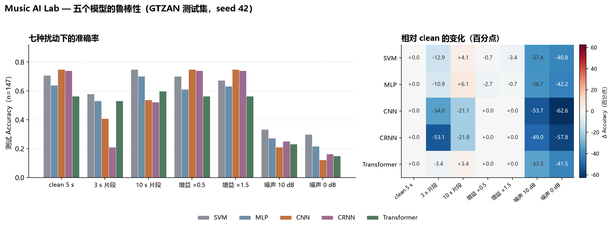

# P0 鲁棒性实验：五个模型在七种扰动下的稳定性

> 对应 `README.md`「下一步计划」中的 P0「鲁棒性实验」。本文所有数字来自一次真实运行
> （`results/robustness.csv`，35 行），没有手工填写或估算的结果。
> 运行日期：2026-10-19；环境：WSL2 + conda `DataAnalysis`（Python 3.12 / torch 2.12.1+cu130 /
> RTX 4060 8 GB）；评估对象：seed 42 的五个 checkpoint。

---

## 一、实验目标

训练集上的准确率只说明模型在「干净、5 秒、中心片段」这一种输入上表现如何。
本实验回答三个问题：

1. 把同一批测试曲目换一种「听法」（更短/更长、更轻/更响、加噪声），五个模型各掉多少？
2. 谁对增益、噪声、片段长度最敏感？敏感的是深度模型还是传统模型？
3. 干净输入上的冠军，在扰动下还是冠军吗？

模型**只做推理、不重新训练、不做数据增强**，因此这里测的是「现成权重面对分布外输入」
的脆弱性，而不是「加增强后能有多稳」。

---

## 二、协议

| 项 | 设置 |
|---|---|
| 测试集 | `data/splits/splits.csv` 中 `split=test` 的 147 首（GTZAN 清洗后 985 首的 15%） |
| 权重 | `checkpoints/{svm,mlp}_seed42.joblib`、`{cnn,crnn,transformer}_seed42.pt` |
| 传统模型输入 | 对扰动后的波形重新计算 209 维人工特征（`src.data.audio_features.handcrafted`） |
| 深度模型输入 | 对扰动后的波形重新计算 64×216 log-Mel；归一化统计量取 checkpoint 内的 `norm`（训练集拟合值），**不在测试集重拟合** |
| 指标 | Accuracy、Macro-F1（10 类，`labels=range(10)`，与训练脚本一致） |
| 决策规则 | SVM/MLP 用 `.predict()`（与训练/评估一致），深度模型用 softmax argmax；SVM 的 Platt 概率与 OVO 决策在约 7% 样本上不同，故不使用概率 argmax |
| 行数 | 5 模型 × 7 条件 = 35 行，每行 n=147 |
| 随机性 | 分割 seed=42；噪声 RNG 以 `crc32(track_id|condition)` 定种，可复现 |

### 七个条件

| 条件 | 窗口 | 扰动 | 实现细节 |
|---|---|---|---|
| `clean_5s` | 5 s | 无 | 轨道中心 5 s，与训练/`metrics.csv` 完全一致 |
| `clip_3s` | 3 s | 更短片段 | 中心 3 s；log-Mel 原生 130 帧，逐 Mel bin `np.interp` 线性拉伸到 216 帧 |
| `clip_10s` | 10 s | 更长片段 | 中心 10 s；log-Mel 原生 431 帧，逐 Mel bin 压缩到 216 帧 |
| `gain_0.5` | 5 s | 音量 ×0.5 | 波形乘 0.5，再 clip 到 [-1, 1]，记录削波样本比例 |
| `gain_1.5` | 5 s | 音量 ×1.5 | 波形乘 1.5，再 clip 到 [-1, 1]，记录削波样本比例 |
| `noise_10db` | 5 s | 高斯白噪声，SNR 10 dB | 噪声功率 = 信号功率 / 10^(10/10)，按样本级 SNR 定义；再 clip |
| `noise_0db` | 5 s | 高斯白噪声，SNR 0 dB | 噪声功率 = 信号功率；再 clip |

补充说明：

- 3 s / 10 s 窗口同样取轨道中心，因此**内容**与 5 s 中心片段不同（不是同一段音频的截取）；
  人工特征直接对这些窗口重算均值/标准差。
- 深度模型必须拿到固定 64×216 输入，所以 3 s 与 10 s 的频谱在时间轴上被线性插值：
  3 s 为 1.66 倍拉伸，10 s 为 2 倍压缩。这意味着 `clip_3s` / `clip_10s` 同时改变了
  「上下文长度」和「时间轴尺度」，两者无法在本实验里拆开（见第七节）。
- 削波只发生在 `gain_*` 与 `noise_*` 条件；`clean_5s` / `clip_*` 波形不做任何改写。
- `delta_acc` / `delta_f1` 定义为「该条件 − 同一模型 clean」，负值即下降，单位是
  准确率/ F1 的绝对差（表内括号换算为百分点）。

---

## 三、复现命令

```bash
cd /mnt/d/Desktop/MUSIC_AI
PY=/home/weizai0v0/.apps/anaconda3/envs/DataAnalysis/bin/python

# 全量实验：147 首 × 7 条件 × 5 模型
$PY -m src.robustness --workers 12

# 等价入口（只补 sys.path）
$PY scripts/run_robustness.py --workers 12

# 只重画图（读 results/robustness.csv，不重算特征）
$PY -m src.robustness --plot-only

# 冒烟测试：只跑前 6 首，且不写任何结果文件
$PY -m src.robustness --limit 6 --workers 4
```

本机实测：12 个 worker，147×7 特征提取约 29 s，含 35 次模型推理的总耗时 79–86 s（多次重跑）。
产物只有以下文件：

- `src/robustness.py`（模块，含 `main()`）
- `scripts/run_robustness.py`（薄入口）
- `results/robustness.csv`（35 行）
- `results/figures/robustness.png`
- 本文档

---

## 四、自检：clean 条件必须复现训练时的评估

在信任任何扰动结果之前，先验证这套推理路径与训练脚本一致：

| 检查 | 结果 |
|---|---|
| 重算的 clean_5s 人工特征 vs `data/processed/features.npz` | 平均绝对误差 `7.06e-09` |
| 重算的 clean_5s log-Mel vs 缓存 `X_mel`（float16） | 平均绝对误差 `6.64e-03` dB（仅为缓存半精度舍入） |
| clean_5s Accuracy vs `results/metrics.csv`（seed 42） | SVM 0.7075、MLP 0.6395、CNN 0.7483、CRNN 0.7415、Transformer 0.5646，**五个模型的差均为 0.0000** |

也就是说，表中的 clean 行与此前报告的成绩逐位一致，下面的掉点可以放心归因于扰动本身。

---

## 五、结果

### 5.1 Accuracy（括号内为相对 clean 的变化，百分点）

| 条件 | SVM | MLP | CNN | CRNN | Transformer |
|---|---|---|---|---|---|
| clean_5s | 0.7075 | 0.6395 | 0.7483 | 0.7415 | 0.5646 |
| clip_3s | 0.5782 (-12.9) | 0.5306 (-10.9) | 0.4082 (-34.0) | 0.2109 (-53.1) | 0.5306 (-3.4) |
| clip_10s | 0.7483 (+4.1) | 0.7007 (+6.1) | 0.5374 (-21.1) | 0.5238 (-21.8) | 0.5986 (+3.4) |
| gain_0.5 | 0.7007 (-0.7) | 0.6122 (-2.7) | 0.7483 (+0.0) | 0.7415 (+0.0) | 0.5646 (+0.0) |
| gain_1.5 | 0.6735 (-3.4) | 0.6327 (-0.7) | 0.7483 (+0.0) | 0.7415 (+0.0) | 0.5646 (+0.0) |
| noise_10db | 0.3333 (-37.4) | 0.2721 (-36.7) | 0.2109 (-53.7) | 0.2517 (-49.0) | 0.2313 (-33.3) |
| noise_0db | 0.2993 (-40.8) | 0.2177 (-42.2) | 0.1224 (-62.6) | 0.1633 (-57.8) | 0.1497 (-41.5) |

### 5.2 Macro-F1（括号内为变化，百分点）

| 条件 | SVM | MLP | CNN | CRNN | Transformer |
|---|---|---|---|---|---|
| clean_5s | 0.6987 | 0.6331 | 0.7493 | 0.7411 | 0.5566 |
| clip_3s | 0.5628 (-13.6) | 0.5332 (-10.0) | 0.4023 (-34.7) | 0.1694 (-57.2) | 0.5252 (-3.1) |
| clip_10s | 0.7463 (+4.8) | 0.6912 (+5.8) | 0.5304 (-21.9) | 0.4906 (-25.1) | 0.5947 (+3.8) |
| gain_0.5 | 0.6909 (-0.8) | 0.6041 (-2.9) | 0.7493 (+0.0) | 0.7411 (+0.0) | 0.5566 (+0.0) |
| gain_1.5 | 0.6598 (-3.9) | 0.6273 (-0.6) | 0.7492 (-0.0) | 0.7411 (+0.0) | 0.5558 (-0.1) |
| noise_10db | 0.2476 (-45.1) | 0.2078 (-42.5) | 0.1654 (-58.4) | 0.1672 (-57.4) | 0.1934 (-36.3) |
| noise_0db | 0.2151 (-48.4) | 0.1451 (-48.8) | 0.0409 (-70.8) | 0.0825 (-65.9) | 0.0813 (-47.5) |

Macro-F1 的降幅普遍比 Accuracy 更大：噪声条件下模型不是「随机猜」，而是把多数样本
推向少数几个流派，导致宏平均被拖垮（如 CNN 在 0 dB 时 F1 只剩 0.041）。



### 5.3 每个模型的「干净 vs 最差」

| 模型 | clean Acc | clean F1 | 最差条件 | 最差 Acc | 掉点(pp) | 六种扰动的平均 \|ΔAcc\|(pp) |
|---|---|---|---|---|---|---|---|
| SVM | 0.7075 | 0.6987 | noise_0db | 0.2993 | -40.8 | 16.6 |
| MLP | 0.6395 | 0.6331 | noise_0db | 0.2177 | -42.2 | 16.6 |
| CNN | 0.7483 | 0.7493 | noise_0db | 0.1224 | -62.6 | 28.6 |
| CRNN | 0.7415 | 0.7411 | noise_0db | 0.1633 | -57.8 | 30.3 |
| Transformer | 0.5646 | 0.5566 | noise_0db | 0.1497 | -41.5 | 13.6 |

### 5.4 预测翻转数（相对 clean，单位：首 / 147）

| 模型 | clip_3s | clip_10s | gain_0.5 | gain_1.5 | noise_10db | noise_0db |
|---|---|---|---|---|---|---|
| SVM | 46 | 26 | 18 | 15 | 94 | 98 |
| MLP | 54 | 29 | 14 | 19 | 104 | 116 |
| CNN | 74 | 58 | 0 | 2 | 109 | 128 |
| CRNN | 114 | 71 | 0 | 0 | 108 | 120 |
| Transformer | 45 | 36 | 0 | 8 | 110 | 126 |

注意 `gain_1.5`：深度模型准确率几乎不变，但 CNN 有 2 首、Transformer 有 8 首预测翻转
（对错相抵），这些翻转来自约 0.47% 被削波的样本，不是音量本身。

### 5.5 按条件看整体（五模型平均掉点）

| 条件 | 平均掉点(pp) | 该条件最佳模型 |
|---|---|---|
| clip_3s | -22.9 | SVM（0.578） |
| clip_10s | -5.9 | SVM（0.748） |
| gain_0.5 | -0.7 | CNN（0.748） |
| gain_1.5 | -0.8 | CNN（0.748） |
| noise_10db | -42.0 | SVM（0.333） |
| noise_0db | -49.0 | SVM（0.299） |

---

## 六、结论

### 6.1 对增益最敏感：传统模型，深度模型几乎零变化

- 深度模型在 `gain_0.5` / `gain_1.5` 下准确率变化为 **0.0 pp**，只有极少数预测翻转。
- SVM 掉 0.7 / 3.4 pp，MLP 掉 2.7 / 0.7 pp。
- 这不是巧合，而是两套表示的性质差异：
  - 深度模型的 log-Mel 用 `power_to_db(..., ref=np.max)`，按每个片段自身最大值归一化，
    整体乘一个常数后 dB 值**严格不变**（实测 clean 与 ×0.5 的 log-Mel 平均绝对差
    `1.4e-6` dB）。因此只要不削波，深度模型对纯增益免疫。
  - 人工特征里的 MFCC 是绝对 dB（`librosa.feature.mfcc` 默认 `ref=1.0`），还包含
    RMS 均值/标准差；音量变化会直接移动 MFCC c0 与 RMS 两三项，而 StandardScaler
    是在干净训练集上拟合的，所以 SVM/MLP 会把「变轻」当成分布外输入。
- 1.5 倍增益开始出现削波（平均 0.47% 样本、最坏一首 9.93%），此时深度模型的
  零变化被打破：2 首 CNN、8 首 Transformer 预测翻转，只是对错抵消。
- **副作用**：`ref=np.max` 让深度模型免于增益影响，同时也让 log-Mel 对噪声地板异常敏感
  （见 6.3），这是同一枚硬币的两面。

### 6.2 对片段长度最敏感：CRNN 与 CNN；传统模型反而喜欢更长的窗口

- 3 秒片段：CRNN 崩到 0.211（-53.1 pp），CNN 0.408（-34.0 pp）；SVM 0.578（-12.9），
  MLP 0.531（-10.9），Transformer 只掉 3.4 pp。
- 10 秒片段：CRNN -21.8、CNN -21.1 pp；SVM/MLP 反而**提升** 4.1 / 6.1 pp，
  Transformer +3.4 pp。
- 一个合理但未经单独验证的解释：3 s→216 帧是 1.66 倍拉伸、10 s→216 帧是 2 倍压缩，
  深度模型（尤其 CRNN 的 GRU）学到的是固定时间尺度上的局部节奏模式，时间轴一旦
  被拉伸/压缩，鼓点间距、音素长度全部错位；CNN 的卷积核同样如此。
  人工特征是整段均值/标准差，窗口更长反而让统计量更稳（10 s 提升），窗口过短则
  方差变大（3 s 掉点）。
- 结论要谨慎：这两个条件同时改变了「上下文长度」和「时间轴尺度」，
  不能把掉点全部记在「片段短/长」头上。

### 6.3 对噪声最敏感：所有模型，深度模型最惨

- 10 dB SNR：平均掉 42.0 pp；CNN -53.7、CRNN -49.0、SVM -37.4、MLP -36.7、
  Transformer -33.3。
- 0 dB SNR：平均掉 49.0 pp；CNN 只剩 0.1224（-62.6 pp），CRNN 0.1633（-57.8 pp），
  SVM 0.2993（-40.8 pp）。
- 干净数据上的冠军 CNN，在 0 dB 噪声下是**五个模型里最差的**。深度模型的领先优势
  完全建立在「输入分布与训练一致」这个前提上。
- 机制（本实验可直接验证的部分）：
  1. log-Mel 以每个片段的最大值为 0 dB、默认 `top_db=80`，所以安静频段被压到 -80 dB；
     加入白噪声会把这条「动态范围地板」整体抬起来。抽查 `blues.00008`：clean 的
     log-Mel 最小值 -80 dB，10 dB SNR 时变成 -46.3 dB —— 波形 SNR 听起来只是
     「有点底噪」，但在归一化后的频谱里，安静帧移动了几十 dB，相当于强烈的分布外输入。
  2. 一次 20 首的机制抽查（不在 35 行表内）：即使 SNR 30 dB（几乎听不出的底噪），
     clean vs noisy 的 log-Mel 平均绝对差已有 2.2 dB、最大 29 dB，CNN 在该子集上
     从 0.85 掉到 0.25。说明本实验的「噪声」远不是波形层面的小扰动。
  3. 五个模型训练时都没有噪声增强；人工特征同样是绝对 dB，噪声抬高了 MFCC c0、
     谱质心/带宽/rolloff 与 ZCR，StandardScaler 同样把它当分布外。
- 因此噪声实验的结论不是「模型怕吵」，而是：**当前特征表示 + 无增强训练的组合，
  对加性噪声没有任何防御**。若要做现场演示，这是最值得讲的一组数字；若要改进，
  应优先加噪声增强（波形域）或改用对增益/噪声更稳健的归一化（如固定 dB 参考、
  每帧 CMVN），而不是只换更大的模型。

### 6.4 谁最稳？要分「绝对成绩」和「相对波动」看

- 按六种扰动的平均 |ΔAcc|：Transformer 13.6 < SVM 16.6 ≈ MLP 16.6 < CNN 28.6 <
  CRNN 30.3 pp。Transformer「最稳」，但它的 clean 成绩只有 0.5646，本身就没学到
  多少可被破坏的结构，不能把「稳」直接解读为「鲁棒」。
- 按扰动后的绝对准确率：除增益条件外，**SVM 是每个条件下的第一名**
  （3 s 0.578、10 s 0.748、10 dB 0.333、0 dB 0.299）。深度模型在 clean 上领先
  CNN +4.1 pp，但在 3 s 与噪声条件下反而落后 SVM 12–18 pp。
- 一句话总结：**深度模型赢在干净输入，传统模型赢在输入变脏时**；这正好呼应
  README 里「深度模型不是免费午餐」的观察，并把它推进了一步。

---

## 七、局限与注意事项

1. **只评估 seed 42**。`--seed` 可换其他种子，但本文与 CSV 是 seed 42 的结果；
   多 seed 下 clean 基线本身有 ±0.7–5.1 pp 的波动（见 README 6.2），
   扰动掉点也应视为单次抽样。
2. **n=147，单次评估的绝对准确率 95% 置信区间约 ±7 pp**（如 0.748 时约 ±7.0 pp）。
   同一批曲目上的条件间比较是配对的，误差更小，但 3–6 pp 量级的变化
   （如 clip_10s 下 SVM/MLP 的提升）仍不宜过度解读。
3. **3 s / 10 s 不只是长度变化**：log-Mel 被插值到 216 帧，时间尺度被拉伸/压缩，
   与「换一段更短/更长的音频」并不等价；人工特征也换成了不同窗口的内容。
4. **噪声只取了一次随机抽样**（每首、每条件一个固定种子）。换一批噪声实现，
   具体数值会有波动；结论方向（噪声主导掉点）在 30 dB 抽查中已可见。
5. **削波是协议的一部分**：增益与噪声后统一 clip 到 [-1, 1]，削波比例已记录在
   运行日志中（`gain_1.5` 平均 0.47%、最大 9.93%；`noise_0db` 平均 0.20%、最大 6.47%）；
   0 dB 噪声的削波比例很小，掉点主要来自噪声本身，而非削波。
6. **没有重训练/微调**：本实验测的是「现成权重 + 无增强」的脆弱性上限，
   不代表这些架构在噪声增强训练后仍如此。
7. **GTZAN 自身的标签噪声与重复曲目**会影响绝对数值；本实验只做模型间相对比较。
8. 鲁棒性只覆盖测试集 147 首、每首中心窗口；曲目首尾段落、变速、混响、压缩失真等
   常见现场扰动未纳入。

---

## 八、产物与追溯

| 文件 | 内容 |
|---|---|
| `src/robustness.py` | 条件定义、音频加载/扰动/log-Mel 插值、并行特征提取、五模型推理、CSV/图生成 |
| `scripts/run_robustness.py` | 薄入口，`python scripts/run_robustness.py --workers 12` |
| `results/robustness.csv` | 35 行原始结果，列：`model,condition,n,accuracy,macro_f1,delta_acc,delta_f1` |
| `results/robustness_flips.csv` | 相对 clean 的预测翻转数（35 行，`scripts/robustness_flips.py`） |
| `results/figures/robustness.png` | 左：七条件分组柱状（Accuracy）；右：相对 clean 的 ΔAcc 热力图 |
| `docs/robustness.md` | 本文档 |

表中每个数字都可用第三节的命令重跑得到；clean 行已与 `results/metrics.csv` 对账一致。
